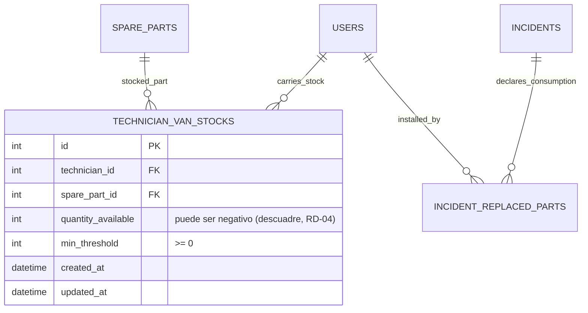

# ESPECIFICACIÓN TÉCNICA · CONTRATOS DE API Y MODELO DE DATOS
# STOCK DE REPUESTOS EN FURGONETA (VAN STOCK) (MÓDULO 18)

**Proyecto:** Gestor de Incidencias de Vending (*VendGuard*)  
**Módulo:** `18-van-stock`  
**Documento:** `specs/technical/van_stock_contracts.md`  
**Referencia Funcional:** [`specs/18-van-stock/spec.md`](../18-van-stock/spec.md) (RF-01 a RF-06, RNF-01 a RNF-05)  
**Protocolo:** HTTP/1.1 · JSON (`application/json; charset=utf-8`)  
**Metodología:** SDD (Specification-Driven Development) · Contratos API-First  
**Conformidad Constitucional:**
* **Artículo I:** La Especificación es la Única Fuente de Verdad. Ninguna implementación sin contrato previo; cero código simulado.
* **Artículo III:** Inviolabilidad de Datos e Histórico. La tabla nueva lleva disparador `trg_no_delete_*`; la baja de una fila es lógica (cantidad `0`). Toda mutación del coordinador deja evento en `audit_log`.
* **Artículo IV:** Minimalismo Tecnológico y Cero Bloatware. PHP 8.2+ POO puro tipado con PDO; Vue 3 estándar. Cero dependencias nuevas.
* **Artículo V:** Integridad Inviolable de Reglas de Negocio.
  * Art. V.1 (cierre justificado) y Art. II (prioridad sanitaria): **el descuento de stock jamás puede impedir** resolver una avería o completar un preventivo (RD-04).
  * Art. V.4 (privacidad y segregación): la sede no ve stock, cantidades ni umbrales. El técnico solo ve su propio inventario y solo en lectura.
* **Artículo VI.1:** Alcance mínimo autorizado por el Product Owner (2026-10-21): stock, descuento automático y alerta. El albarán de reposición automática queda excluido (spec §2.2).

---

## 1. Principios Arquitectónicos del Módulo

### 1.1. Un único punto de descuento (RF-02.1)
Existe **un solo método de consumo** (`VanStockService::consume()`) invocado desde los dos caminos que ya persisten líneas de pieza sustituida. No se implementa lógica de decremento por camino ni por interfaz de usuario.

### 1.2. Aritmética honesta y sin coste (RD-04, RD-05)
La tabla almacena **solo unidades y umbral**. No hay coste, valoración, ni precio de compra: el coste del repuesto ya se congela de forma inmutable en `incident_replaced_parts.unit_cost_snapshot` (M2). La cantidad puede ser negativa y ese estado es un dato de negocio válido (descuadre de carga), no un error que deba ocultarse.

### 1.3. Sin transacción nueva (RD-02)
El descuento se ejecuta con **una única sentencia atómica** (`INSERT ... ON CONFLICT ... DO UPDATE`), ejecutada en la misma unidad de escritura que la línea de pieza sustituida, sin abrir, ampliar ni reordenar la transacción del flujo de cierre existente.

---

## 2. Modelo de Datos

### 2.1. Modelo Entidad-Relación (Mermaid ERD)



La relación con el consumo es **derivada, no almacenada**: `incident_replaced_parts` sigue siendo el libro de consumo inmutable (Art. III.3) y la tabla de stock es el saldo declarado del vehículo.

### 2.2. DDL de la tabla (forma canónica, `database/supabase_init.sql` §7)

```sql
-- -----------------------------------------------------------------------------
-- Tabla 26 · technician_van_stocks — inventario declarado de la furgoneta
--   (Módulo 18 · RF-01, RD-04)
-- -----------------------------------------------------------------------------
-- La cantidad admite negativos a propósito: significan que se declararon más
-- unidades instaladas de las que constaban cargadas, y esa señal operativa no se
-- trunca a cero ni bloquea el cierre de la avería (Art. V.1 y Art. II). La
-- unicidad es por pareja técnico/pieza; no se guarda ningún coste, porque el
-- coste del repuesto ya se congela inmutablemente en `incident_replaced_parts`
-- (RD-05).
CREATE TABLE IF NOT EXISTS technician_van_stocks (
    id                 BIGINT GENERATED ALWAYS AS IDENTITY,
    technician_id      BIGINT NOT NULL,
    spare_part_id      BIGINT NOT NULL,
    quantity_available INTEGER NOT NULL DEFAULT 0,
    min_threshold      INTEGER NOT NULL DEFAULT 0,
    created_at         TIMESTAMPTZ NOT NULL DEFAULT CURRENT_TIMESTAMP,
    updated_at         TIMESTAMPTZ NOT NULL DEFAULT CURRENT_TIMESTAMP,
    CONSTRAINT pk_technician_van_stocks PRIMARY KEY (id),
    CONSTRAINT uq_van_stock_technician_part UNIQUE (technician_id, spare_part_id),
    CONSTRAINT chk_van_stock_quantity_range CHECK (quantity_available BETWEEN -999 AND 9999),
    CONSTRAINT chk_van_stock_threshold_range CHECK (min_threshold BETWEEN 0 AND 9999),
    CONSTRAINT fk_van_stock_technician FOREIGN KEY (technician_id)
        REFERENCES users (id) ON DELETE RESTRICT ON UPDATE CASCADE,
    CONSTRAINT fk_van_stock_spare_part FOREIGN KEY (spare_part_id)
        REFERENCES spare_parts (id) ON DELETE RESTRICT ON UPDATE CASCADE
);

CREATE INDEX IF NOT EXISTS idx_van_stock_technician
    ON technician_van_stocks (technician_id);

CREATE INDEX IF NOT EXISTS idx_van_stock_spare_part
    ON technician_van_stocks (spare_part_id);

CREATE OR REPLACE TRIGGER trg_no_delete_technician_van_stocks
    BEFORE DELETE ON technician_van_stocks
    FOR EACH ROW EXECUTE FUNCTION prevent_hard_delete();

CREATE OR REPLACE TRIGGER trg_touch_technician_van_stocks
    BEFORE UPDATE ON technician_van_stocks
    FOR EACH ROW EXECUTE FUNCTION touch_updated_at();
```

### 2.3. Extensión del enum de auditoría (RF-05.1)

```sql
ALTER TYPE audit_entity_type ADD VALUE IF NOT EXISTS 'TECHNICIAN_VAN_STOCK';
```

Se declara también en la lista de valores de `audit_entity_type` de `database/supabase_init.sql` y en su inventario comentado de enums, siguiendo exactamente el patrón de `007_operational_zones.sql:182-183`. El recuento de 30 tipos `ENUM` del contrato **no cambia** (se añade un valor, no un tipo).

---

## 3. Objetos de Dominio (PHP 8.2+)

### 3.1. Entidad y DTO

```php
declare(strict_types=1);

namespace VendGuard\Core\Domain\Model;

/**
 * Saldo declarado de una pieza en la furgoneta de un técnico (RF-01).
 * `quantityAvailable` admite negativos: es el descuadre declarado, no un error (RD-04).
 */
final class VanStockItem
{
    public const QUANTITY_MIN = -999;
    public const QUANTITY_MAX = 9999;
    public const THRESHOLD_MIN = 0;
    public const THRESHOLD_MAX = 9999;

    public function __construct(
        public readonly ?int $id,
        public readonly int $technicianId,
        public readonly int $sparePartId,
        public readonly int $quantityAvailable,
        public readonly int $minThreshold
    ) {
        if ($quantityAvailable < self::QUANTITY_MIN || $quantityAvailable > self::QUANTITY_MAX) {
            throw new \InvalidArgumentException('La cantidad disponible debe estar entre -999 y 9999 unidades.');
        }
        if ($minThreshold < self::THRESHOLD_MIN || $minThreshold > self::THRESHOLD_MAX) {
            throw new \InvalidArgumentException('El umbral mínimo debe estar entre 0 y 9999 unidades.');
        }
    }

    /** RF-03.1: bajo umbral cuando la cantidad no supera el umbral declarado. */
    public function isBelowThreshold(): bool
    {
        return $this->quantityAvailable <= $this->minThreshold;
    }

    /** RF-03.3: descuadre cuando se declararon más unidades de las cargadas. */
    public function isNegative(): bool
    {
        return $this->quantityAvailable < 0;
    }
}
```

### 3.2. Servicio de aplicación

```php
namespace VendGuard\Application\Service;

final class VanStockService
{
    /** RF-01.1 / RF-05.1: alta o ajuste absoluto con auditoría del delta. */
    public function setStock(int $technicianId, int $sparePartId, int $quantity, int $minThreshold, ?array $actor): VanStockItem;

    /** RF-02.1: único punto de descuento, atómico y llamado por ambos caminos de declaración. */
    public function consume(int $technicianId, int $sparePartId, int $quantity): void;

    /** RF-03.2: parejas bajo umbral, ordenadas por severidad. */
    public function listBelowThreshold(?int $technicianId = null): array;

    /** RF-04.1: inventario completo del propio técnico. */
    public function listByTechnician(int $technicianId): array;
}
```

### 3.3. Inyección y compatibilidad de pruebas
`SparePartTraceabilityService` recibe `VanStockService` por constructor junto a sus repositorios actuales. **Consecuencia declarada:** los stubs de repositorio de los tests unitarios que implementan las interfaces de dominio afectadas deben actualizarse en el mismo cambio (guarda §5 del plan).

---

## 4. Endpoints de API (Contratos HTTP)

### 4.1. `GET /api/technician/van-stock` — inventario propio (RF-04.1)

* **Seguridad:** `TECHNICIAN`. El endpoint **no acepta** ningún parámetro de técnico: siempre devuelve el del sujeto autenticado (RF-04.3).
* **Respuesta Exitosa (200 OK):**
```json
{
  "technician_id": 7,
  "items": [
    {
      "spare_part_id": 1,
      "part_code": "VALV-ULKA-01",
      "name": "Electroválvula 24V Ulka",
      "category": "HYDRAULIC",
      "quantity_available": 2,
      "min_threshold": 3,
      "is_below_threshold": true
    },
    {
      "spare_part_id": 9,
      "part_code": "JUN-TEFL-09",
      "name": "Junta de teflón del grupo de infusión",
      "category": "CONSUMABLE",
      "quantity_available": -1,
      "min_threshold": 0,
      "is_below_threshold": true
    }
  ]
}
```
* **Notas:** sin importes ni costes (Art. V.4). Estado vacío = `items: []` con `200`, y la interfaz muestra el estado vacío explicativo (RF-04.3).

---

### 4.2. `GET /api/coordinator/van-stocks` — inventario y alerta (RF-03, RF-04.2)

* **Seguridad:** `COORDINATOR`.
* **Query Parameters:**
  * `technician_id` (int, opcional): limita el inventario a un técnico.
  * `below_threshold` (int, opcional): `1` devuelve **solo** las parejas bajo umbral, ya ordenadas por severidad. Es la fuente de la alerta de RF-03.2.
* **Respuesta Exitosa (200 OK, `below_threshold=1`):**
```json
{
  "below_threshold": true,
  "items": [
    {
      "technician_id": 7,
      "technician_name": "Carlos Rodríguez",
      "operator_code": "OP-02",
      "spare_part_id": 9,
      "part_code": "JUN-TEFL-09",
      "name": "Junta de teflón del grupo de infusión",
      "quantity_available": -1,
      "min_threshold": 0,
      "is_below_threshold": true,
      "is_negative": true
    }
  ]
}
```

---

### 4.3. `PUT /api/coordinator/van-stocks` — carga y ajuste (RF-01.1)

* **Seguridad:** `COORDINATOR`. Una sesión de `TECHNICIAN` recibe `403` (RF-04.3).
* **Cuerpo de Solicitud (JSON):**
```json
{
  "technician_id": 7,
  "spare_part_id": 1,
  "quantity_available": 5,
  "min_threshold": 2
}
```
* **Semántica:** **valor absoluto**, no delta. Es un *upsert* sobre la pareja `(technician_id, spare_part_id)`: si la fila no existe se crea con los valores indicados, si existe se sobrescribe cantidad y umbral. El evento de auditoría registra el delta respecto al valor previo (RF-05.1).
* **Validaciones:**
  * `technician_id` y `spare_part_id`: enteros positivos obligatorios.
  * `quantity_available`: entero entre `-999` y `9999` (el negativo es válido: registra un descuadre declarado, RD-04).
  * `min_threshold`: entero entre `0` y `9999`.
  * La pieza debe existir en `spare_parts` (se admiten piezas con baja lógica: una furgoneta puede conservar una pieza descatalogada).
  * El usuario destino debe existir; su rol debe ser `TECHNICIAN`.
* **Respuesta Exitosa (200 OK):**
```json
{
  "technician_id": 7,
  "spare_part_id": 1,
  "quantity_available": 5,
  "min_threshold": 2,
  "is_below_threshold": false,
  "previous_quantity_available": 2,
  "message": "El stock de la furgoneta ha sido actualizado con éxito."
}
```

---

## 5. Catálogo de Errores Técnicos

Los errores se emiten con el sobre ya existente en el proyecto, `Response::error($code, $message, $httpStatus)`.

| Código de Error | HTTP Status | Mensaje en Español | Causa Disparadora |
| :--- | :---: | :--- | :--- |
| `INVALID_VAN_STOCK_PAYLOAD` | 422 | Los datos del stock son incompletos o erróneos. | Falta `technician_id`/`spare_part_id` o el tipo no es entero positivo. |
| `INVALID_VAN_STOCK_QUANTITY` | 422 | La cantidad disponible debe estar entre -999 y 9999 unidades y el umbral entre 0 y 9999. | Cifra fuera de las cotas anti-errata declaradas. |
| `VAN_STOCK_TARGET_NOT_FOUND` | 404 | No se encontró el técnico o la pieza indicados. | `technician_id` o `spare_part_id` inexistentes en el dominio. |
| `VAN_STOCK_ROLE_NOT_TECHNICIAN` | 422 | El stock solo puede asignarse a un usuario con rol de técnico. | El usuario destino existe pero no es `TECHNICIAN`. |

El `403` de las rutas internas lo produce `InternalAuthMiddleware` al no coincidir el rol, con el mismo comportamiento que el resto de endpoints internos: **no se introduce código de error nuevo** para ese caso.

---

## 6. Consultas SQL del Módulo

### 6.1. Descuento atómico por consumo (RF-02, RD-02)

Una única sentencia crea la fila si no existe (partiendo de `0`) y descuenta en el mismo acto, sin lectura previa y sin carrera:

```sql
INSERT INTO technician_van_stocks (technician_id, spare_part_id, quantity_available, min_threshold)
VALUES (:technician_id, :spare_part_id, -(:quantity), 0)
ON CONFLICT (technician_id, spare_part_id)
DO UPDATE SET
    quantity_available = technician_van_stocks.quantity_available - :quantity,
    updated_at = CURRENT_TIMESTAMP;
```

### 6.2. Ajuste absoluto por el coordinador (RF-01.1)

```sql
INSERT INTO technician_van_stocks (technician_id, spare_part_id, quantity_available, min_threshold)
VALUES (:technician_id, :spare_part_id, :quantity_available, :min_threshold)
ON CONFLICT (technician_id, spare_part_id)
DO UPDATE SET
    quantity_available = EXCLUDED.quantity_available,
    min_threshold      = EXCLUDED.min_threshold,
    updated_at         = CURRENT_TIMESTAMP
RETURNING id, quantity_available, min_threshold;
```

### 6.3. Alerta de stock bajo (RF-03.2)

```sql
SELECT vs.technician_id, u.name AS technician_name, u.operator_code,
       vs.spare_part_id, sp.part_code, sp.name AS part_name,
       vs.quantity_available, vs.min_threshold
FROM technician_van_stocks vs
INNER JOIN users u ON u.id = vs.technician_id
INNER JOIN spare_parts sp ON sp.id = vs.spare_part_id
WHERE vs.quantity_available <= vs.min_threshold
  AND (:technician_id IS NULL OR vs.technician_id = :technician_id)
ORDER BY (vs.quantity_available < 0) DESC, vs.quantity_available ASC, u.name ASC;
```

El primer criterio de orden pone delante los descuadres negativos (PostgreSQL ordena `TRUE` primero en `DESC`), que es la severidad máxima declarada en RF-03.2.

---

## 7. Verificación de Privacidad (Art. V.4)

1. Ninguna ruta de este módulo se registra en el portal de sede ni en el escaneo público: solo `TECHNICIAN` y `COORDINATOR` (RF-06.1).
2. El saneador de respuestas al portal de sede amplía su lista de claves vedadas con las claves del módulo (`quantity_available`, `min_threshold`, `van_stock`, `technician_van_stocks`), de modo que ninguna fuga futura por esa vía sea silenciosa.
3. Una suite constitucional propia (`VanStockPrivacyTest`) demuestra el `403` para sesión de sede y la ausencia de claves de stock en las proyecciones de sede.
4. El payload del técnico no incluye importes ni costes de pieza en ningún caso (RF-04.1).

---

## 8. Trazabilidad Documental

* **Canónico funcional:** [`specs/18-van-stock/spec.md`](../18-van-stock/spec.md) (aprobado por el Product Owner el 2026-10-21).
* **Diseño e implementación:** [`specs/18-van-stock/plan.md`](../18-van-stock/plan.md) y [`specs/18-van-stock/tasks.md`](../18-van-stock/tasks.md).
* **Base heredada:** [`specs/technical/spare_parts_contracts.md`](spare_parts_contracts.md) (catálogo maestro, snapshot de coste, exclusión de albaranes) y [`specs/technical/schema_correspondence_contract.md`](schema_correspondence_contract.md) (inventario de tablas, que este módulo amplía).
