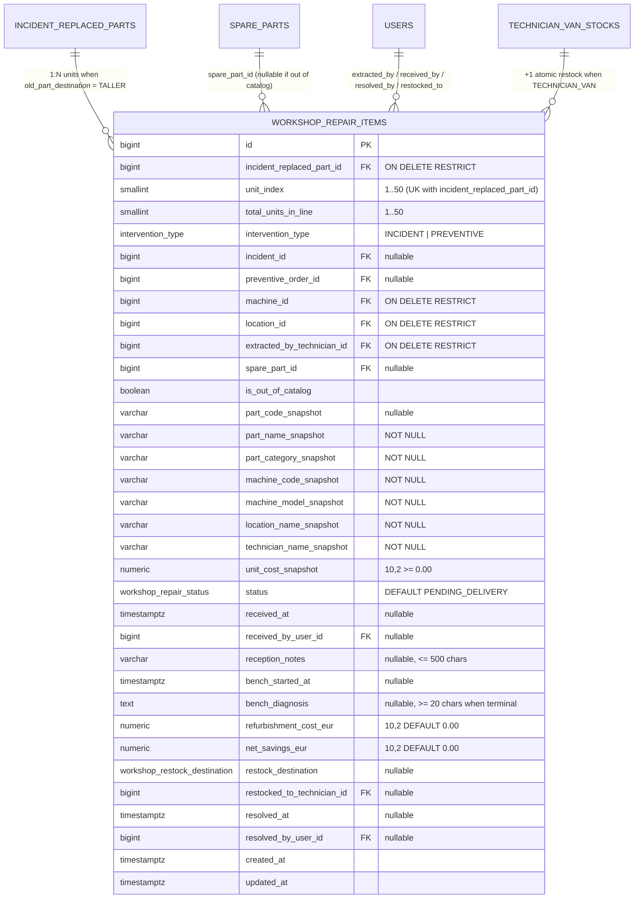

# ESPECIFICACIÓN TÉCNICA · CONTRATOS DE API, ESQUEMA RELACIONAL Y ECONOMÍA CIRCULAR
# BANDEJA DE TALLER CENTRAL PARA PIEZAS RECUPERADAS (MÓDULO 27)

**Proyecto:** Gestor de Incidencias de Vending (*VendGuard*)  
**Módulo:** `27-workshop-refurbishment-loop`  
**Documento:** `specs/technical/workshop_refurbishment_loop_contracts.md`  
**Referencia Funcional:** [`specs/27-workshop-refurbishment-loop/spec.md`](../27-workshop-refurbishment-loop/spec.md) y [`specs/functional/workshop_refurbishment_loop_spec.md`](../functional/workshop_refurbishment_loop_spec.md) (`RF-01` a `RF-05`, Decisiones `D1`–`D4`)  
**Protocolo:** HTTP/1.1 · JSON (`application/json; charset=utf-8`) y `text/csv; charset=UTF-8`  
**Metodología:** SDD (Specification-Driven Development) · Contratos API-First  
**Conformidad Constitucional:**
* **Art. I:** Supremacía de la especificación; cero mocks en producción.
* **Art. II:** La creación de `workshop_repair_items` en el cierre técnico jamás bloquea una resolución ni altera la prioridad sanitaria.
* **Art. III.1 y III.3:** La Tabla 38 `workshop_repair_items` porta el disparador constitucional `trg_no_delete_workshop_repair_items` (`prevent_hard_delete()`) y congela los snapshots de pieza, coste unitario a nuevo, máquina, sede y técnico. Todas las transiciones se auditan en `audit_log` bajo `audit_entity_type = 'WORKSHOP_REPAIR_ITEM'`.
* **Art. IV:** PHP 8.2+ POO puro (`declare(strict_types=1);`), PostgreSQL 16+ (`pdo_pgsql`) y Vue 3 Composition API (ES Modules) sin librerías de terceros nuevas.
* **Art. V.1:** Restricción `chk_workshop_repair_bench_diagnosis_len` en base de datos y validador de dominio que exigen `char_length(btrim(bench_diagnosis)) >= 20` para cualquier estado terminal (`REFURBISHED_RESTORED` o `SCRAPPED_IRREPARABLE`).
* **Art. V.4:** Segregación estricta de privacidad: los importes (`unit_cost_snapshot`, `refurbishment_cost_eur`, `net_savings_eur`), diagnósticos de banco y métricas de taller pertenecen exclusivamente a `COORDINATOR`. El bloque `pending_workshop_deliveries` expuesto al `TECHNICIAN` omite todo dato económico, y el Portal de Sede / QR / Albarán A4 tienen opacidad absoluta.

---

## 1. Modelo de Datos Relacional (PostgreSQL 16+ / Supabase)

### 1.1. Diagrama Entidad-Relación (Mermaid ERD)



### 1.2. Nuevos Tipos Enumerados y Ampliación de `audit_entity_type`

1. **`workshop_repair_status`** (5 estados canónicos):
   * `'PENDING_DELIVERY'` — En furgoneta del técnico, pendiente de entrega física en Taller Central.
   * `'RECEIVED_IN_WORKSHOP'` — Recepcionada físicamente en el Taller Central por Coordinación.
   * `'IN_BENCH_TEST'` — En comprobación o reparación activa en el banco de pruebas.
   * `'REFURBISHED_RESTORED'` — Estado terminal: pieza reacondicionada con éxito y reincorporada a stock.
   * `'SCRAPPED_IRREPARABLE'` — Estado terminal: pieza irrecuperable enviada a desguace/reciclaje definitivo.
2. **`workshop_restock_destination`** (2 destinos de reincorporación para unidades `REFURBISHED_RESTORED`):
   * `'CENTRAL_WAREHOUSE'` — Almacén Central / Reserva de Taller.
   * `'TECHNICIAN_VAN'` — Furgoneta de un técnico activo (`+1` en `technician_van_stocks`).
3. **Ampliación de `audit_entity_type`:**
   ```sql
   ALTER TYPE audit_entity_type ADD VALUE IF NOT EXISTS 'WORKSHOP_REPAIR_ITEM';
   ```

### 1.3. DDL Canónico de la Tabla 38 (`database/supabase_migrations/023_workshop_repair_items.sql` y `database/supabase_init.sql`)

```sql
DO $do$
BEGIN
    CREATE TYPE workshop_repair_status AS ENUM (
        'PENDING_DELIVERY',
        'RECEIVED_IN_WORKSHOP',
        'IN_BENCH_TEST',
        'REFURBISHED_RESTORED',
        'SCRAPPED_IRREPARABLE'
    );
EXCEPTION WHEN duplicate_object THEN NULL;
END $do$;

DO $do$
BEGIN
    CREATE TYPE workshop_restock_destination AS ENUM (
        'CENTRAL_WAREHOUSE',
        'TECHNICIAN_VAN'
    );
EXCEPTION WHEN duplicate_object THEN NULL;
END $do$;

ALTER TYPE audit_entity_type ADD VALUE IF NOT EXISTS 'WORKSHOP_REPAIR_ITEM';

CREATE TABLE IF NOT EXISTS workshop_repair_items (
    id                          BIGINT GENERATED ALWAYS AS IDENTITY,
    incident_replaced_part_id   BIGINT NOT NULL,
    unit_index                  SMALLINT NOT NULL DEFAULT 1,
    total_units_in_line         SMALLINT NOT NULL DEFAULT 1,
    intervention_type           intervention_type NOT NULL,
    incident_id                 BIGINT,
    preventive_order_id         BIGINT,
    machine_id                  BIGINT NOT NULL,
    location_id                 BIGINT NOT NULL,
    extracted_by_technician_id  BIGINT NOT NULL,
    spare_part_id               BIGINT,
    is_out_of_catalog           BOOLEAN NOT NULL DEFAULT FALSE,
    part_code_snapshot          VARCHAR(64),
    part_name_snapshot          VARCHAR(255) NOT NULL,
    part_category_snapshot      VARCHAR(32) NOT NULL DEFAULT 'OTHER',
    machine_code_snapshot       VARCHAR(50) NOT NULL,
    machine_model_snapshot      VARCHAR(100) NOT NULL,
    location_name_snapshot      VARCHAR(150) NOT NULL,
    technician_name_snapshot    VARCHAR(100) NOT NULL,
    unit_cost_snapshot          NUMERIC(10, 2) NOT NULL DEFAULT 0.00,
    status                      workshop_repair_status NOT NULL DEFAULT 'PENDING_DELIVERY',
    received_at                 TIMESTAMPTZ,
    received_by_user_id         BIGINT,
    reception_notes             VARCHAR(500),
    bench_started_at            TIMESTAMPTZ,
    bench_diagnosis             TEXT,
    refurbishment_cost_eur      NUMERIC(10, 2) NOT NULL DEFAULT 0.00,
    net_savings_eur             NUMERIC(10, 2) NOT NULL DEFAULT 0.00,
    restock_destination         workshop_restock_destination,
    restocked_to_technician_id  BIGINT,
    resolved_at                 TIMESTAMPTZ,
    resolved_by_user_id         BIGINT,
    created_at                  TIMESTAMPTZ NOT NULL DEFAULT CURRENT_TIMESTAMP,
    updated_at                  TIMESTAMPTZ NOT NULL DEFAULT CURRENT_TIMESTAMP,
    CONSTRAINT pk_workshop_repair_items PRIMARY KEY (id),
    CONSTRAINT uq_workshop_repair_replaced_part_unit UNIQUE (incident_replaced_part_id, unit_index),
    CONSTRAINT fk_workshop_repair_replaced_part FOREIGN KEY (incident_replaced_part_id)
        REFERENCES incident_replaced_parts (id) ON DELETE RESTRICT ON UPDATE CASCADE,
    CONSTRAINT fk_workshop_repair_incident FOREIGN KEY (incident_id)
        REFERENCES incidents (id) ON DELETE RESTRICT ON UPDATE CASCADE,
    CONSTRAINT fk_workshop_repair_preventive FOREIGN KEY (preventive_order_id)
        REFERENCES preventive_orders (id) ON DELETE RESTRICT ON UPDATE CASCADE,
    CONSTRAINT fk_workshop_repair_machine FOREIGN KEY (machine_id)
        REFERENCES machines (id) ON DELETE RESTRICT ON UPDATE CASCADE,
    CONSTRAINT fk_workshop_repair_location FOREIGN KEY (location_id)
        REFERENCES locations (id) ON DELETE RESTRICT ON UPDATE CASCADE,
    CONSTRAINT fk_workshop_repair_extracted_tech FOREIGN KEY (extracted_by_technician_id)
        REFERENCES users (id) ON DELETE RESTRICT ON UPDATE CASCADE,
    CONSTRAINT fk_workshop_repair_spare_part FOREIGN KEY (spare_part_id)
        REFERENCES spare_parts (id) ON DELETE RESTRICT ON UPDATE CASCADE,
    CONSTRAINT fk_workshop_repair_received_by FOREIGN KEY (received_by_user_id)
        REFERENCES users (id) ON DELETE RESTRICT ON UPDATE CASCADE,
    CONSTRAINT fk_workshop_repair_restocked_tech FOREIGN KEY (restocked_to_technician_id)
        REFERENCES users (id) ON DELETE RESTRICT ON UPDATE CASCADE,
    CONSTRAINT fk_workshop_repair_resolved_by FOREIGN KEY (resolved_by_user_id)
        REFERENCES users (id) ON DELETE RESTRICT ON UPDATE CASCADE,
    CONSTRAINT chk_workshop_repair_unit_bounds CHECK (
        unit_index >= 1 AND total_units_in_line >= 1 AND unit_index <= total_units_in_line AND total_units_in_line <= 50
    ),
    CONSTRAINT chk_workshop_repair_costs_non_negative CHECK (
        unit_cost_snapshot >= 0.00
        AND refurbishment_cost_eur >= 0.00
        AND refurbishment_cost_eur <= 9999.99
        AND net_savings_eur >= 0.00
    ),
    CONSTRAINT chk_workshop_repair_reception_notes_len CHECK (
        reception_notes IS NULL OR char_length(btrim(reception_notes)) BETWEEN 1 AND 500
    ),
    CONSTRAINT chk_workshop_repair_bench_diagnosis_len CHECK (
        bench_diagnosis IS NULL OR char_length(btrim(bench_diagnosis)) BETWEEN 20 AND 1000
    ),
    CONSTRAINT chk_workshop_repair_terminal_coherence CHECK (
        (
            status IN ('PENDING_DELIVERY', 'RECEIVED_IN_WORKSHOP', 'IN_BENCH_TEST')
            AND resolved_at IS NULL
            AND resolved_by_user_id IS NULL
            AND restock_destination IS NULL
            AND restocked_to_technician_id IS NULL
        )
        OR (
            status = 'REFURBISHED_RESTORED'
            AND received_at IS NOT NULL
            AND bench_started_at IS NOT NULL
            AND bench_diagnosis IS NOT NULL
            AND char_length(btrim(bench_diagnosis)) BETWEEN 20 AND 1000
            AND resolved_at IS NOT NULL
            AND resolved_by_user_id IS NOT NULL
            AND restock_destination IS NOT NULL
            AND (
                (restock_destination = 'CENTRAL_WAREHOUSE' AND restocked_to_technician_id IS NULL)
                OR (restock_destination = 'TECHNICIAN_VAN' AND restocked_to_technician_id IS NOT NULL AND is_out_of_catalog = FALSE AND spare_part_id IS NOT NULL)
            )
        )
        OR (
            status = 'SCRAPPED_IRREPARABLE'
            AND (
                (received_at IS NULL AND bench_started_at IS NULL)
                OR (received_at IS NOT NULL AND bench_started_at IS NOT NULL)
            )
            AND bench_diagnosis IS NOT NULL
            AND char_length(btrim(bench_diagnosis)) BETWEEN 20 AND 1000
            AND resolved_at IS NOT NULL
            AND resolved_by_user_id IS NOT NULL
            AND restock_destination IS NULL
            AND restocked_to_technician_id IS NULL
            AND refurbishment_cost_eur = 0.00
            AND net_savings_eur = 0.00
        )
    )
);

CREATE INDEX IF NOT EXISTS idx_workshop_repair_status_created
    ON workshop_repair_items (status, created_at DESC);
CREATE INDEX IF NOT EXISTS idx_workshop_repair_extracted_tech
    ON workshop_repair_items (extracted_by_technician_id, status);
CREATE INDEX IF NOT EXISTS idx_workshop_repair_spare_part
    ON workshop_repair_items (spare_part_id, status);

CREATE OR REPLACE TRIGGER trg_no_delete_workshop_repair_items
    BEFORE DELETE ON workshop_repair_items
    FOR EACH ROW EXECUTE FUNCTION prevent_hard_delete();

CREATE OR REPLACE TRIGGER trg_touch_workshop_repair_items
    BEFORE UPDATE ON workshop_repair_items
    FOR EACH ROW EXECUTE FUNCTION touch_updated_at();
```

---

## 2. Contratos de Endpoints REST

### 2.1. `GET /api/coordinator/workshop-items`
* **Autenticación y Autorización:** Exclusivo `COORDINATOR` (`401`/`403` para cualquier otro rol).
* **Query Params opcionales:**
  * `status`: `ALL` (default) | `PENDING_DELIVERY` | `RECEIVED_IN_WORKSHOP` | `IN_BENCH_TEST` | `REFURBISHED_RESTORED` | `SCRAPPED_IRREPARABLE`
  * `technician_id`: entero positivo (filtra por `extracted_by_technician_id`)
  * `category`: `ALL` (default) | `PAYMENT` | `COOLING` | `DISPENSING` | `ELECTRONICS` | `WATER_COFFEE` | `OTHER`
  * `search`: búsqueda insensible a mayúsculas sobre código/nombre de pieza, código de máquina, sede o diagnóstico de banco.
* **Respuesta `200 OK` (con `summary` calculado sobre los filtros `technician_id`, `category` y `search`, inmune al cambio de pestaña `status` según `QA 2`):**
  ```json
  {
    "summary": {
      "pending_delivery_count": 2,
      "received_in_workshop_count": 1,
      "in_bench_test_count": 1,
      "in_workshop_count": 2,
      "refurbished_count": 3,
      "scrapped_in_bench_count": 1,
      "scrapped_unreceived_count": 0,
      "scrapped_count": 1,
      "evaluated_in_workshop_count": 4,
      "resolved_total_count": 4,
      "recovery_rate_pct": 75.00,
      "total_reference_value_eur": 640.00,
      "total_refurbishment_cost_eur": 18.50,
      "total_net_savings_eur": 481.50
    },
    "items": [
      {
        "id": 1,
        "incident_replaced_part_id": 10,
        "unit_index": 1,
        "total_units_in_line": 1,
        "unit_badge": "1/1",
        "intervention_type": "INCIDENT",
        "incident_id": 4,
        "ticket_code": "INC-2026-0004",
        "preventive_order_id": null,
        "preventive_order_code": null,
        "machine_id": 2,
        "machine_code": "VM-MAD-002",
        "machine_model": "Jofemar Vision",
        "location_id": 1,
        "location_name": "Hospital Universitario Central",
        "extracted_by_technician_id": 2,
        "technician_name": "Carlos Ruiz",
        "spare_part_id": 1,
        "is_out_of_catalog": false,
        "part_code": "PAY-MDB-001",
        "part_name": "Selector de Monedas MDB Jofemar J2000",
        "part_category": "PAYMENT",
        "unit_cost_snapshot": 185.00,
        "status": "REFURBISHED_RESTORED",
        "status_label": "Reacondicionada y Restaurada",
        "received_at": "2026-11-01T17:30:00+01:00",
        "received_by_user_id": 1,
        "reception_notes": "Entregado al cierre de ruta tarde",
        "bench_started_at": "2026-11-02T09:15:00+01:00",
        "bench_diagnosis": "Limpieza ultrasónica de sensores ópticos y sustitución de condensador electrolítico C14 en placa.",
        "refurbishment_cost_eur": 4.50,
        "net_savings_eur": 180.50,
        "restock_destination": "TECHNICIAN_VAN",
        "restocked_to_technician_id": 2,
        "restocked_to_technician_name": "Carlos Ruiz",
        "resolved_at": "2026-11-02T11:40:00+01:00",
        "resolved_by_user_id": 1,
        "created_at": "2026-11-01T14:20:00+01:00"
      }
    ]
  }
  ```

### 2.2. `POST /api/coordinator/workshop-items/{id}/receive`
* **Propósito:** Confirma la recepción física de la unidad en el Taller Central (`PENDING_DELIVERY` $\rightarrow$ `RECEIVED_IN_WORKSHOP`).
* **Body JSON:**
  ```json
  {
    "reception_notes": "Entregada en almacén central sin daños externos visibles"
  }
  ```
* **Errores:**
  * `404 WORKSHOP_ITEM_NOT_FOUND` si no existe.
  * `409 INVALID_WORKSHOP_STATUS_TRANSITION` si no está en `PENDING_DELIVERY`.
  * `422 INVALID_RECEPTION_NOTES_LENGTH` si `reception_notes` supera 500 caracteres.

### 2.3. `POST /api/coordinator/workshop-items/{id}/start-bench`
* **Propósito:** Registra el inicio de comprobación en el banco de pruebas (`RECEIVED_IN_WORKSHOP` $\rightarrow$ `IN_BENCH_TEST`).
* **Errores:**
  * `409 INVALID_WORKSHOP_STATUS_TRANSITION` si el estado actual no es `RECEIVED_IN_WORKSHOP`.

### 2.4. `POST /api/coordinator/workshop-items/{id}/resolve`
* **Propósito:** Emite el dictamen técnico final (`REFURBISHED_RESTORED` o `SCRAPPED_IRREPARABLE`) desde `RECEIVED_IN_WORKSHOP` o `IN_BENCH_TEST`, calcula el ahorro neto y, si el destino es `TECHNICIAN_VAN`, incrementa atómicamente `+1` en `technician_van_stocks`.
* **Body JSON (Caso `REFURBISHED_RESTORED`):**
  ```json
  {
    "outcome_status": "REFURBISHED_RESTORED",
    "bench_diagnosis": "Sustitución de correa dentada interna, recalibración de sensores ópticos y prueba de 200 ciclos en banco sin atascos.",
    "refurbishment_cost_eur": 6.50,
    "restock_destination": "TECHNICIAN_VAN",
    "restocked_to_technician_id": 2
  }
  ```
* **Body JSON (Caso `SCRAPPED_IRREPARABLE`):**
  ```json
  {
    "outcome_status": "SCRAPPED_IRREPARABLE",
    "bench_diagnosis": "Microcontrolador principal en cortocircuito por sobretensión; pista multicapa carbonizada sin posibilidad de recuperación."
  }
  ```
* **Códigos de Error de Negocio:**
  * `409 INVALID_WORKSHOP_STATUS_TRANSITION` si ya está en un estado terminal, o si sigue en `PENDING_DELIVERY` y se solicita `REFURBISHED_RESTORED` (desde `PENDING_DELIVERY` solo se admite `SCRAPPED_IRREPARABLE` para baja justificada por extravío/no entrega, `C1`).
  * `422 INVALID_WORKSHOP_OUTCOME` si `outcome_status` no es `'REFURBISHED_RESTORED'` ni `'SCRAPPED_IRREPARABLE'`.
  * `422 INVALID_BENCH_DIAGNOSIS_LENGTH` si `bench_diagnosis` tiene menos de 20 caracteres significativos tras `trim()` (Art. V.1).
  * `422 INVALID_REFURBISHMENT_COST` si `refurbishment_cost_eur` no es numérico, es negativo (`< 0.00`) o supera el tope `9999.99`.
  * `422 INVALID_RESTOCK_DESTINATION` si en `REFURBISHED_RESTORED` no es `'CENTRAL_WAREHOUSE'` ni `'TECHNICIAN_VAN'`.
  * `422 OUT_OF_CATALOG_CANNOT_RESTOCK_VAN` si `is_out_of_catalog = TRUE` y se solicita `'TECHNICIAN_VAN'`.
  * `422 INACTIVE_SPARE_PART_CANNOT_RESTOCK_VAN` si la referencia en `spare_parts` está desactivada (`is_active = FALSE` o `deleted_at IS NOT NULL`) y se solicita `'TECHNICIAN_VAN'` (`C3`).
  * `422 INVALID_RESTOCK_TECHNICIAN` si `restock_destination = 'TECHNICIAN_VAN'` y `restocked_to_technician_id` falta, no existe, no tiene rol `'TECHNICIAN'` o está inactivo (`C3`).
  * `422 VAN_STOCK_MAX_CAPACITY_REACHED` si la furgoneta del técnico destinatario ya tiene `9999` unidades disponibles de esa pieza (`QA 3`).

### 2.5. `GET /api/coordinator/workshop-items/export` (`QA 5`)
* **Propósito:** Descarga el informe CSV (`text/csv; charset=UTF-8`) con `UTF-8 BOM` (`\xEF\xBB\xBF`) y separador `;` aplicando los mismos filtros de consulta que `GET /api/coordinator/workshop-items` y registrando el evento `EXPORT_WORKSHOP_ITEMS_CSV` en `audit_log`.
* **Formato de Fechas e Importes:** Marcas temporales en huso horario `Europe/Madrid` (`YYYY-MM-DD HH:MM:SS`), importes/porcentajes con punto decimal y 2 decimales (`0.00`), booleanos como `Sí`/`No`.
* **Estructura en Dos Secciones (`QA 5`):**
  1. **Sección 1 (Resumen de Indicadores):**
     ```csv
     Indicador;Valor
     Pendientes en Furgoneta;2
     Recibidas en Taller;1
     En Banco de Pruebas;1
     Total en Taller / Banco;2
     Reacondicionadas y Restauradas;3
     Desguazadas en Banco;1
     Bajas sin Recepción (Extraviadas);0
     Tasa de Recuperación (%);75.00
     Valor de Reposición a Nuevo Acumulado (EUR);640.00
     Coste Total de Reparación (EUR);18.50
     Ahorro Neto Acumulado (EUR);481.50
     ```
  2. **Línea en blanco separadora** seguida de la **Sección 2 (Detalle Nominal de Unidades en Taller — 24 columnas):**
     ```csv
     ID Ficha;Unidad;Estado;Origen;Código Aviso / Orden;Código Máquina;Modelo Máquina;Sede;Técnico Extractor;Código Pieza;Nombre Pieza;Categoría;Fuera de Catálogo;Valor Pieza Nueva (EUR);Fecha Retirada;Fecha Recepción Taller;Nota Recepción;Fecha Inicio Banco;Diagnóstico de Banco;Coste Reparación (EUR);Ahorro Neto (EUR);Destino Reincorporación;Técnico Destinatario;Fecha Dictamen
     ```

### 2.6. Enriquecimiento de `GET /api/technician/van-stock` (Módulo 18 + Módulo 27, `D2`, `QA 2`, `QA 4`)
* **Propósito:** Añadir al JSON devuelto al técnico autenticado las claves `pending_workshop_deliveries_count` y `pending_workshop_deliveries` (filtradas estrictamente por `extracted_by_technician_id = token.user_id` y `status = 'PENDING_DELIVERY'`, ordenadas por `created_at ASC, id ASC`), **omitiendo cualquier importe monetario** (Art. V.4).

---

## 3. Catálogo de Acciones de Auditoría (`audit_log`, Art. III.3 y `QA 1`)

Todas las mutaciones del módulo se registran bajo `entity_type = 'WORKSHOP_REPAIR_ITEM'` con `previous_state` y `new_state` completos:
* `RECEIVE_WORKSHOP_ITEM`: Transición `PENDING_DELIVERY` $\rightarrow$ `RECEIVED_IN_WORKSHOP`.
* `START_WORKSHOP_BENCH_TEST`: Transición `RECEIVED_IN_WORKSHOP` $\rightarrow$ `IN_BENCH_TEST`.
* `SCRAP_UNRECEIVED_WORKSHOP_ITEM`: Baja directa por no entrega `PENDING_DELIVERY` $\rightarrow$ `SCRAPPED_IRREPARABLE` (`C1`, `received_at = NULL`, `bench_started_at = NULL`).
* `REFURBISH_WORKSHOP_ITEM`: Dictamen `REFURBISHED_RESTORED` (hacia `CENTRAL_WAREHOUSE` o `TECHNICIAN_VAN`). Cuando el destino es `TECHNICIAN_VAN`, se registra además el ajuste de saldo en `TECHNICIAN_VAN_STOCK` en la misma transacción.
* `SCRAP_WORKSHOP_ITEM`: Dictamen `SCRAPPED_IRREPARABLE` tras recepción/banco (`received_at IS NOT NULL`, `bench_started_at IS NOT NULL`).
* `EXPORT_WORKSHOP_ITEMS_CSV`: Exportación tabular CSV por Coordinación.
